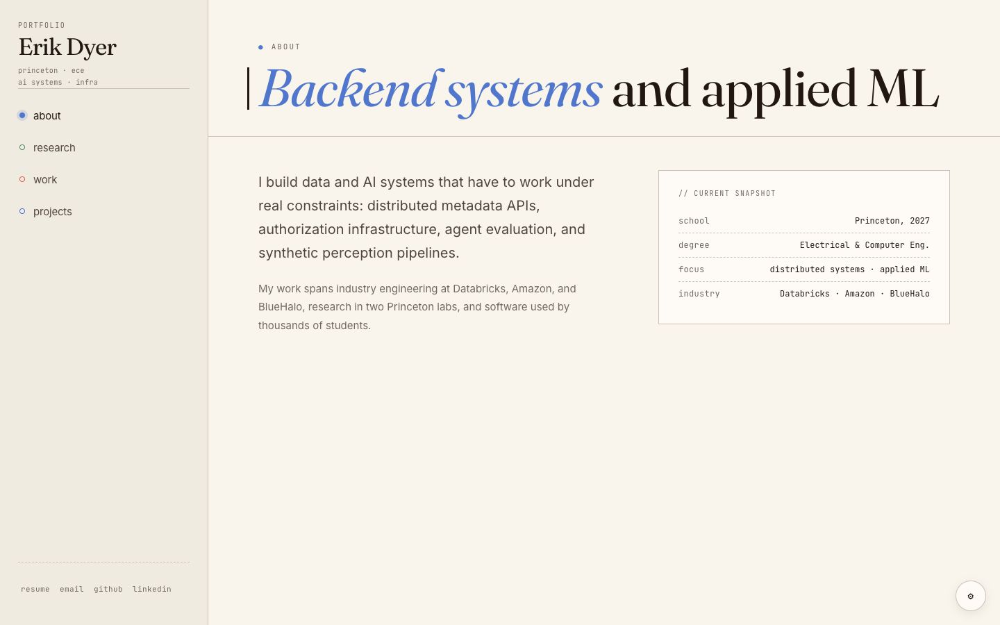

# Erik Dyer's portfolio

[erikdyer.me](https://erikdyer.me) is my personal portfolio: an archival systems notebook for engineering work, research, and selected projects.

The site presents my work across backend and data systems, AI evaluation, reinforcement learning, and 3D perception. Public projects link to their source; private research is labeled and described without exposing private code.



## Technology

- React 18 with small global components
- JSX compiled by esbuild into a single production bundle
- Static hosting through GitHub Pages
- Custom domain with enforced HTTPS

## Run locally

```bash
npm install
npm run build
python3 -m http.server 4173
```

Then open `http://localhost:4173`.

For rebuild-on-change development, use `npm run dev` where recursive file watching is supported.

## Project structure

```text
site/          React source and timeline photography
dist/          checked-in production bundle for GitHub Pages
index.html     document shell, metadata, and shared styles
build.mjs      deterministic esbuild pipeline
PRODUCT.md     audience and content principles
DESIGN.md      visual system and accessibility rules
```

## Verification

```bash
npm run build
git diff --check
```

The interface is reviewed at desktop and mobile widths, with keyboard navigation and reduced-motion behavior included in the acceptance pass.

## Rights

The source is public for portfolio review. No open-source license is granted. Personal photography, writing, and branding remain copyrighted.
