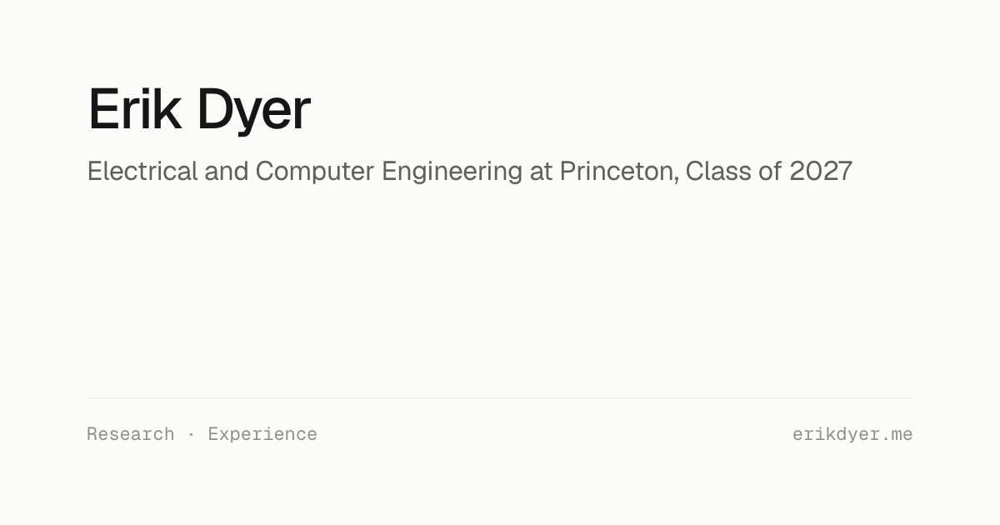

# Erik Dyer's portfolio

[erikdyer.me](https://erikdyer.me) is my personal site: a single, minimal page covering education, research, and engineering experience.



## Technology

- One static `index.html` with inline CSS and a few lines of JavaScript (copy-email)
- Geist and Geist Mono from Google Fonts
- No build step and no dependencies
- Static hosting through GitHub Pages with the custom domain in `CNAME`

## Run locally

```bash
python3 -m http.server 8790
```

Then open `http://localhost:8790`.

## Project structure

```text
index.html     the page: content, styles, and copy-email script
logos/         school, lab, and company marks shown in the logo tiles
favicon.svg    site icon (adapts to light and dark)
og.png         1200x630 social preview image
PRODUCT.md     audience and content principles
DESIGN.md      visual system and accessibility rules
```

## Verification

```bash
git diff --check
```

Review the page at desktop and phone widths, in light and dark mode, and with print preview (it prints as a one-page resume).

## Rights

The source is public for portfolio review. No open-source license is granted. Personal writing and branding remain copyrighted. Company and university logos belong to their owners.
